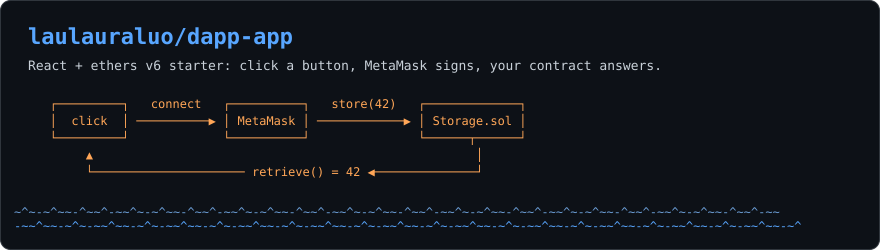
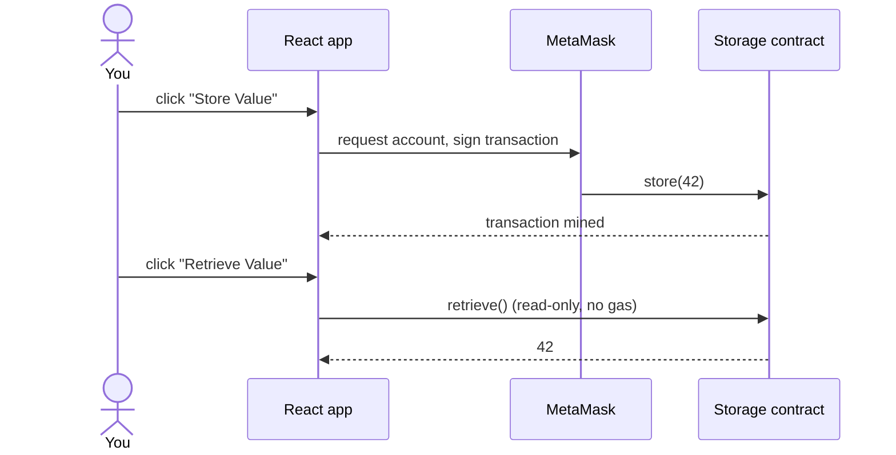
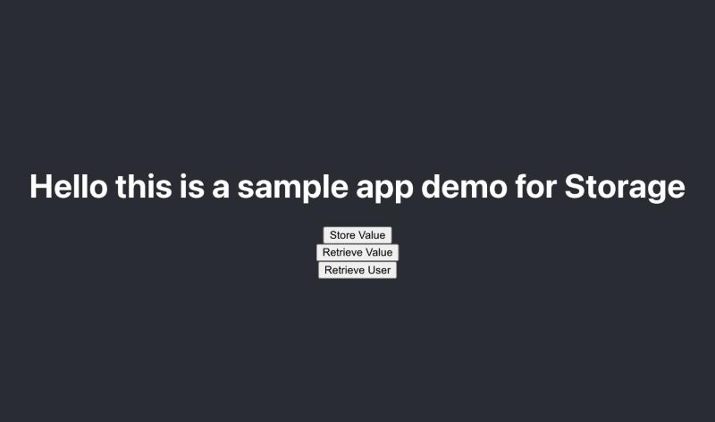

<p align="center">
  <picture>
    <source media="(prefers-color-scheme: dark)" srcset="assets/banner-dark.svg">
    <source media="(prefers-color-scheme: light)" srcset="assets/banner-light.svg">
    
  </picture>
</p>

<p align="center">
  <a href="https://github.com/laulauraluo/dapp-app/generate"></a>
</p>

<p align="center">
  
  
  
  
</p>

<p align="center"><sub>A hackathon kickstarter: clone it, point it at your contract, and spend your time on the UI.</sub></p>

## ⚡ Quick start

You need Node.js, the MetaMask browser extension, and a deployed `Storage` contract on the network MetaMask is using.

```bash
git clone https://github.com/laulauraluo/dapp-app.git
cd dapp-app/dapp-app-fe/react-dapp
npm install
cp .env.example .env   # put your contract address in .env
npm start              # opens http://localhost:3000
```

Click **Retrieve Value**. MetaMask asks to connect, then the stored number appears on the page.

## 🧭 How it works



Every button goes through `src/contract.js`, which connects to MetaMask with ethers v6 `BrowserProvider` and returns a `Contract` bound to your address.

## 🖼️ What you get

<p align="center">
  
</p>

A bare page with one button per contract function, ready for your own design.

## 📦 What's inside

| Path | What it does |
|---|---|
| `dapp-app-fe/react-dapp/src/contract.js` | Connects to MetaMask and wraps each contract call |
| `dapp-app-fe/react-dapp/src/App.js` | Three buttons wired to those calls |
| `dapp-app-fe/react-dapp/src/abi/Storage.json` | Hardhat artifact for `Storage`: ABI and bytecode |
| `dapp-app-fe/react-dapp/.env.example` | The one setting you need: `REACT_APP_CONTRACT_ADDRESS` |

The `Storage` contract interface, from the ABI:

| Function | Kind | Button |
|---|---|---|
| `store(uint256)` | write | **Store Value** (stores 42) |
| `retrieve() returns (uint256)` | read | **Retrieve Value** |
| `retrieveUser() returns (address)` | read | **Retrieve User** |
| `register()` | payable write | not wired yet |

## 🚀 Deploy the contract

`src/abi/Storage.json` contains the compiled bytecode, so any tool that takes an ABI plus bytecode can deploy it (for example ethers' `ContractFactory` or a Hardhat script). Copy the deployed address into `.env` and restart `npm start`.

## 🛠️ Make it yours

1. Replace `src/abi/Storage.json` with your own contract's artifact (Hardhat writes it to `artifacts/contracts/<Name>.sol/<Name>.json`).
2. Set `REACT_APP_CONTRACT_ADDRESS` to your contract.
3. For each contract function, add a small wrapper in `src/contract.js` and a button in `src/App.js`.

Good first change: **Retrieve User** saves the address into the `user` state, but the page does not show it yet.

<details>
<summary>📝 Notes</summary>

- `npm run build` compiles, with two unused-variable lint warnings. The three contract calls were checked against a mocked wallet, not a live chain.
- Create React App is no longer maintained. For a new project, the same `contract.js` works in a Vite app.

</details>
