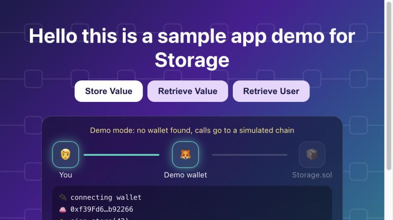
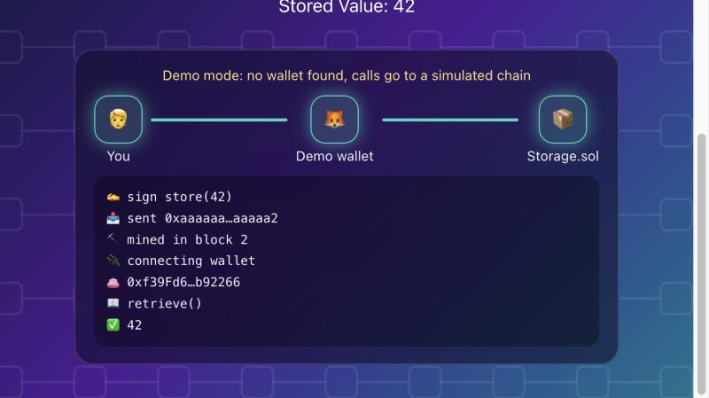
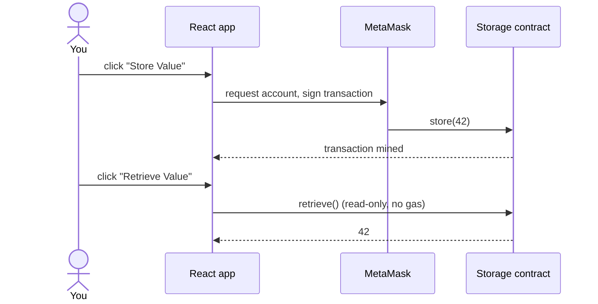

<p align="center">
  <picture>
    <source media="(prefers-color-scheme: dark)" srcset="assets/banner-dark.svg">
    <source media="(prefers-color-scheme: light)" srcset="assets/banner-light.svg">
    
  </picture>
</p>

<p align="center">
  <a href="https://github.com/laulauraluo/dapp-app/generate"></a>
</p>

<p align="center">
  
  
  
  
</p>

<p align="center"><sub>A hackathon kickstarter: clone it, point it at your contract, and spend your time on the UI.</sub></p>

## 🖼️ What you get

<table>
  <tr>
    <td></td>
    <td></td>
  </tr>
  <tr>
    <td align="center"><sub>Store Value, in flight</sub></td>
    <td align="center"><sub>Mined, then read back</sub></td>
  </tr>
</table>

Each click travels **You → Wallet → Storage.sol**, and the panel logs every step. No MetaMask installed? The app switches to a simulated chain, so you can try it right away.

## 🪙 New to crypto? A dapp in two minutes

A normal web app sends your click to the company's server, which writes to the company's database. A **dapp** (decentralized app) sends it to a **smart contract**: a small program that lives on a public blockchain, where anyone can read its data and nobody can quietly change the history.

In this repo the contract is `Storage.sol`, and it holds one number:

- **Store Value** is a *write*. Your wallet signs it, you pay a small fee, and the network records it in a block.
- **Retrieve Value** is a *read*. Anyone can ask for the number, with no signature and no fee.

| Term | In one line | In this app |
|---|---|---|
| Blockchain | A shared database kept by many computers; past entries can't be edited | where `Storage.sol` lives |
| Smart contract | A program on the blockchain, with public code and data | `Storage.sol`: `store`, `retrieve`, `retrieveUser` |
| Wallet | A browser extension holding your private key; it signs requests to prove they come from you | MetaMask, or the demo wallet |
| Transaction | A signed write request | `store(42)` |
| Gas | The fee paid to the network for a write; reads are free | paid on **Store Value** only |
| Block | A batch of transactions added to the chain; your write counts once it's in one | "mined in block 2" |
| ABI | The contract's menu: function names and types, so the frontend knows how to call it | `src/abi/Storage.json` |
| Testnet | A practice network with free test coins | use one (or a local node) before real money |

> Never share your wallet's secret recovery phrase, and try things on a testnet first.

## ⚡ Quick start

You need Node.js. MetaMask and a deployed `Storage` contract are optional: without them the app runs on the demo chain.

```bash
git clone https://github.com/laulauraluo/dapp-app.git
cd dapp-app/dapp-app-fe/react-dapp
npm install
cp .env.example .env   # put your contract address in .env
npm start              # opens http://localhost:3000
```

Click **Store Value**, then **Retrieve Value**, and watch the panel.

## 🧭 How it works



`src/contract.js` connects to the wallet with ethers v6 `BrowserProvider` and returns a `Contract` bound to your address. The visual panel is a separate extension: it listens to the wallet requests the app already makes and draws them, so the app's own code stays as it is.

## 📦 What's inside

| Path (under `dapp-app-fe/react-dapp/`) | What it does |
|---|---|
| `src/contract.js` | Connects to MetaMask and wraps each contract call |
| `src/App.js` | Three buttons wired to those calls |
| `src/abi/Storage.json` | Hardhat artifact for `Storage`: ABI and bytecode |
| `src/extension/` | Optional visual panel, page styling, and the demo chain |
| `.env.example` | The one setting you need: `REACT_APP_CONTRACT_ADDRESS` |

| `Storage` function | Kind | Button |
|---|---|---|
| `store(uint256)` | write | **Store Value** (stores 42) |
| `retrieve() returns (uint256)` | read | **Retrieve Value** |
| `retrieveUser() returns (address)` | read | **Retrieve User** |
| `register()` | payable write | not wired yet |

## 🚀 Deploy the contract

`src/abi/Storage.json` contains the compiled bytecode, so any tool that takes an ABI plus bytecode can deploy it (for example ethers' `ContractFactory` or a Hardhat script). Copy the deployed address into `.env` and restart `npm start`.

## 🛠️ Make it yours

1. Replace `src/abi/Storage.json` with your own contract's artifact (Hardhat writes it to `artifacts/contracts/<Name>.sol/<Name>.json`).
2. Set `REACT_APP_CONTRACT_ADDRESS` to your contract.
3. For each contract function, add a small wrapper in `src/contract.js` and a button in `src/App.js`.
4. Don't want the panel? Delete the `import './extension'` line in `src/index.js`.

Good first change: **Retrieve User** saves the address into the `user` state, but the page does not show it yet (the panel's log does).

<details>
<summary>📝 Notes</summary>

- `npm run build` compiles, with two unused-variable lint warnings in `App.js`.
- `npx react-scripts test src/extension` runs the extension's test: it stores 42 on the demo chain through the app's own `contract.js` and checks the panel. Real-wallet flows were not tested against a live chain.
- Create React App is no longer maintained. For a new project, the same `contract.js` works in a Vite app.

</details>
